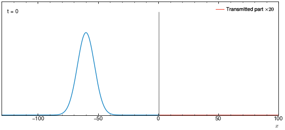
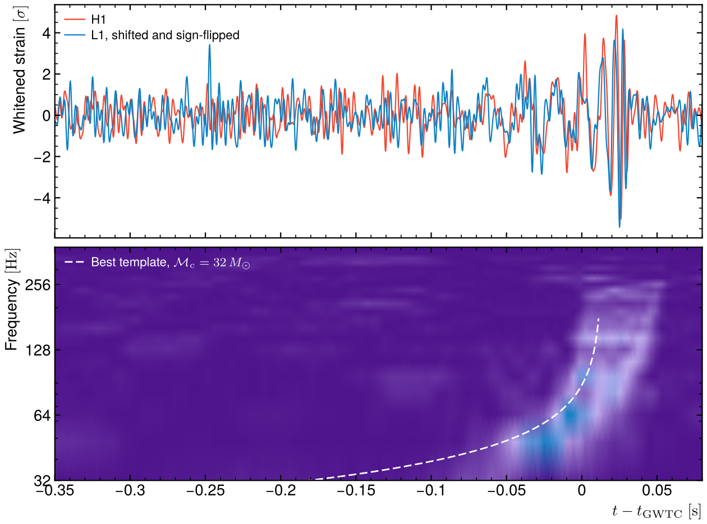
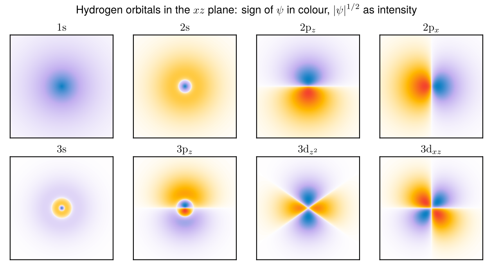
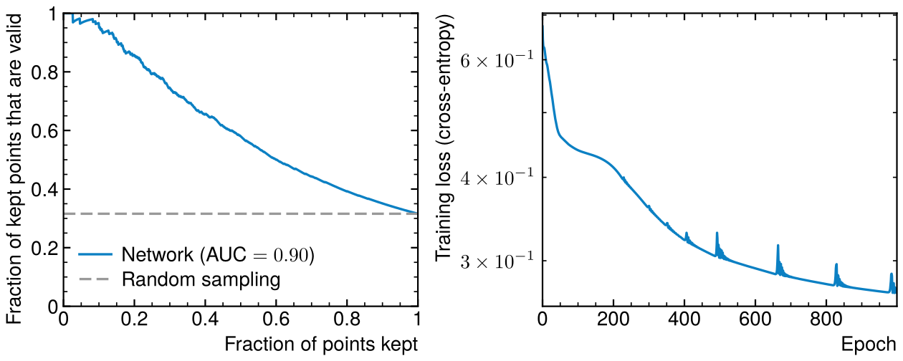
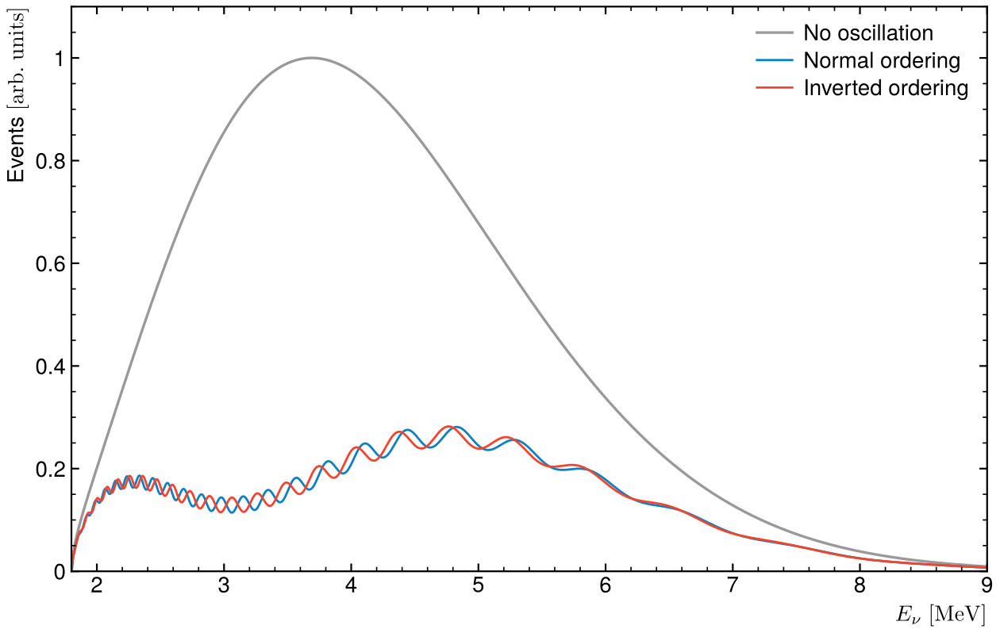
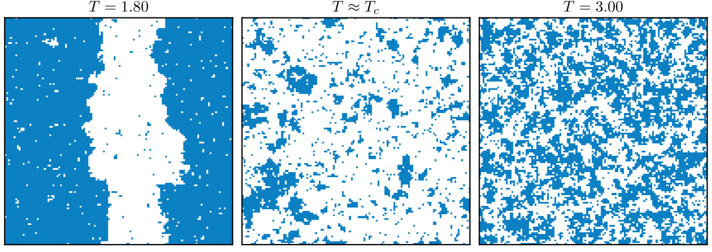
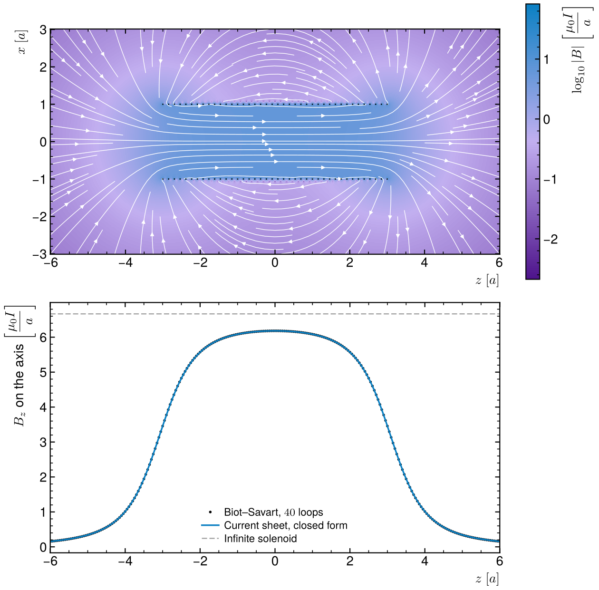
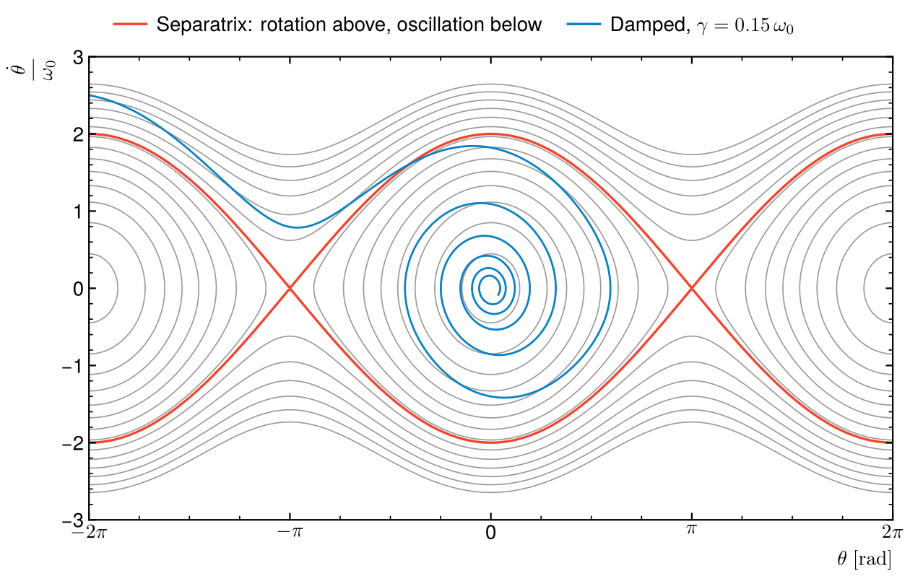
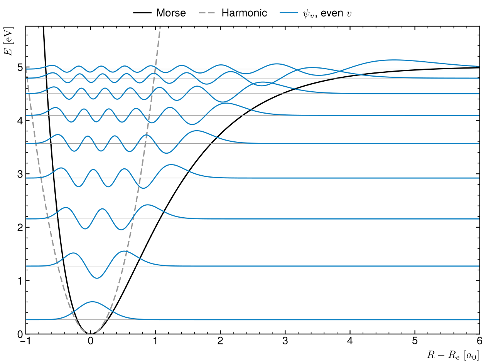

# Personal projects

Physics simulations and small programs I wrote outside my PhD work, mostly
from courses and lab work, cleaned up so each one runs on its own, checks
itself against a known result and makes its figures.

Thirteen projects in quantum mechanics, particle and astroparticle physics,
statistical physics and numerical simulation, from real lab data and open LIGO
data to a neural network trained on supersymmetric spectra. Every result is
checked against an exact formula, a reference table or a published
measurement, and the script fails if it drifts.

<table>
<tr><td width="33%"><a href="quantum/tunnel-effect"></a><br><sub>Quantum tunnelling, split-step Fourier</sub></td><td width="33%"><a href="particle-physics/gravitational-waves"></a><br><sub>GW150914 in open LIGO data</sub></td><td width="33%"><a href="quantum/hydrogen-atom"></a><br><sub>Hydrogen orbitals, s to d</sub></td></tr>
<tr><td width="33%"><a href="particle-physics/pmssm-sampling"></a><br><sub>Neural network on SUSY parameter space</sub></td><td width="33%"><a href="particle-physics/neutrino-oscillations"></a><br><sub>Reactor neutrinos, both mass orderings</sub></td><td width="33%"><a href="statistical-physics/ising"></a><br><sub>2D Ising model across T_c</sub></td></tr>
<tr><td width="33%"><a href="simulations/solenoid"></a><br><sub>Solenoid field from Biot–Savart</sub></td><td width="33%"><a href="simulations/pendulum"></a><br><sub>Pendulum phase space</sub></td><td width="33%"><a href="quantum/h2-molecule"></a><br><sub>H₂ vibrations in a Morse well</sub></td></tr>
</table>

## Quantum mechanics

| Project | What it does | Checked against |
|---|---|---|
| [Tunnel effect](quantum/tunnel-effect) | Gaussian wave packet through a square barrier, split-step Fourier method | Exact transmission, within 4 % at 8 energies |
| [Hydrogen atom](quantum/hydrogen-atom) | Radial Schrödinger equation with finite differences: levels, radial densities and the s, p, d orbitals | Bohr's E_n = −13.6 eV/n², exact Laguerre wave functions |
| [H₂ molecule](quantum/h2-molecule) | LCAO orbitals and bond of H₂⁺, vibrational levels in a Morse potential | Known LCAO bond, exact Morse levels within 0.2 meV |

## Nuclear, particle and astroparticle physics

| Project | What it does | Checked against |
|---|---|---|
| [Gamma attenuation](particle-physics/gamma-attenuation) | Attenuation of ¹³⁷Cs and ²²Na gammas in Al and Cu, measured in an L3 lab | NIST XCOM, within 6 % |
| [Neutrino oscillations](particle-physics/neutrino-oscillations) | Three-flavour oscillations from the PMNS matrix, reactor spectrum for both mass orderings (L3 internship) | Unitarity, closed-form reactor survival, two-flavour limit |
| [pMSSM sampling](particle-physics/pmssm-sampling) | Neural network that predicts which supersymmetric parameter points SOFTSUSY accepts (M1 internship) | Held-out points: ROC AUC and gain over random sampling |
| [GW150914](particle-physics/gravitational-waves) | Matched-filter search for the first black-hole merger in open LIGO data | Catalogue time, Hanford–Livingston delay, chirp mass |

## Classical physics, statistical physics and simulations

| Project | What it does | Checked against |
|---|---|---|
| [2D Ising model](statistical-physics/ising) | Metropolis on a checkerboard: magnetisation, susceptibility, heat capacity across T_c | Onsager's exact magnetisation |
| [Solar system](simulations/solar-system) | Sun and eight planets as an N-body problem, velocity Verlet against Euler | Kepler's third law, energy conservation |
| [Pendulum](simulations/pendulum) | Nonlinear pendulum: period against amplitude, phase portrait, damping | Exact period with the elliptic integral K, to 10⁻⁶ |
| [Solenoid](simulations/solenoid) | Magnetic field of a finite solenoid from Biot–Savart, field lines | One loop on its axis, closed form for a finite solenoid |
| [Molecular dynamics](simulations/molecular-dynamics) | Liquid argon with a Lennard-Jones potential, in C++ (M1 project), simulated annealing into a glass | Maxwell-Boltzmann speeds, energy conservation of 4 integrators |

## Programming

| Project | What it does |
|---|---|
| [2048](https://github.com/MatDplot/jeu-2048) | The 2048 game as a Python package, with tests and Sphinx documentation (own repository) |

## Run

Each folder has its own README. The Python scripts need numpy, scipy and
matplotlib (Pillow for the GIF), listed in `requirements.txt`
(`pip install -r requirements.txt` in a venv), and are run from their folder, for example

```
cd statistical-physics/ising
python3 ising.py
```

Each script stops with an error if its result is off the reference by more
than the tolerance given in its README. The figures shown here were made with
the plotting style of my thesis, which is not part of the repository: without
it the scripts fall back to matplotlib's default style.

That style lives in `_style/` (git-ignored, private), loaded by `figstyle.py`
when the folder is there. It sets the fonts (TeX Gyre Heros, Computer Modern),
renders the text with lualatex through matplotlib's pgf backend and formats
numbers and units with siunitx. Without it every script still runs and checks
its result, but the figures do not come out identical to the ones committed
here: other fonts, mathtext labels, framed legends.

Two scripts need more than Python:

- `particle-physics/gravitational-waves/gw150914.py` downloads the LIGO strain
  from GWOSC (https://gwosc.org) on its first run, 2 × 1.3 MB into its
  `data/` folder (git-ignored). It needs internet once, then works offline.
- `particle-physics/pmssm-sampling/generate.py` needs SOFTSUSY (its README
  says how), and `simulations/molecular-dynamics` needs its C++ results.
  `projets_run` skips both.
