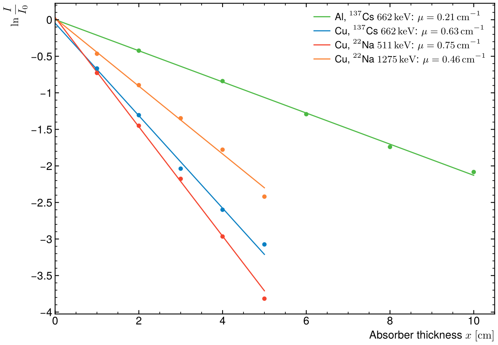

# Attenuation of gamma rays

Lab work from my L3 nuclear physics course: how much of a gamma beam goes
through aluminium and copper, measured with a NaI scintillator and compared
with the NIST cross sections.



## Method

A source sits in front of the detector and absorber plates of growing thickness
x are slid in between. For each thickness the photopeak is integrated over the
same run time. Photons that interact (photoelectric effect, Compton scattering,
pair creation above 1.022 MeV) leave the peak, so the count follows
Beer–Lambert, I(x) = I₀ e^(−μx), and ln(I/I₀) is a straight line of slope −μ.

Sources: ¹³⁷Cs (662 keV line) and ²²Na (511 keV annihilation photons and the
1275 keV line). The fit is weighted by the Poisson errors of the counts.

## Result

| Absorber, line | μ measured (cm⁻¹) | μ NIST (cm⁻¹) | Gap |
|---|---|---|---|
| Al, 662 keV | 0.213 | 0.201 | +6 % |
| Cu, 662 keV | 0.633 | 0.650 | −3 % |
| Cu, 511 keV | 0.748 | 0.741 | +1 % |
| Cu, 1275 keV | 0.464 | 0.467 | −1 % |

NIST values: XCOM mass attenuation coefficients with coherent scattering,
interpolated in log–log between tabulated energies, times the density. μ falls
with energy in copper, as the photoelectric cross section dies out and Compton
scattering takes over.

The fit errors (±0.001 to ±0.004 cm⁻¹) are statistical only. The points
scatter around the lines by more than that: plate thicknesses, the photopeak
window and photons scattered back into the peak are not in the error bars,
which is why the check allows 15 %.

## Run

```
python3 attenuation.py
```

Needs numpy and matplotlib. The counts are in the script.
