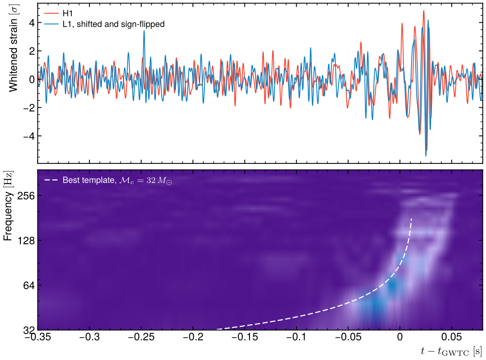
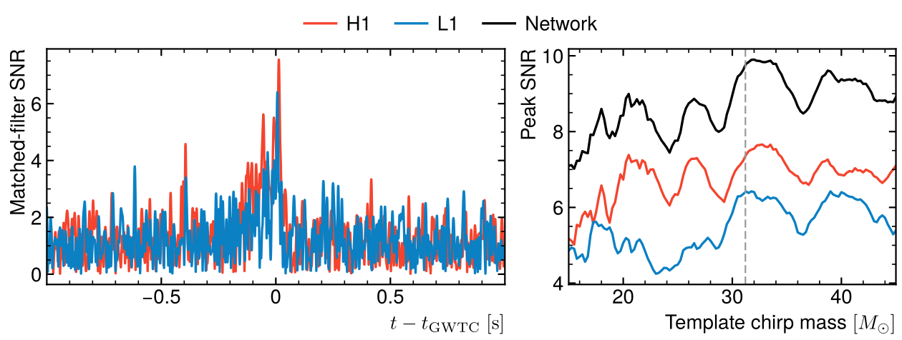

# Finding GW150914 with a matched filter

The first binary black-hole merger seen by LIGO, recovered from the open data
with a few lines of numpy: noise estimation, whitening and a matched filter
over a bank of chirp templates.



## Method

Input: 32 s of strain from Hanford (H1) and Livingston (L1) at 4096 Hz around
the event, downloaded from the Gravitational Wave Open Science Center on the
first run (2 × 1.3 MB, in `data/`).

- The noise power spectral density is estimated from the data themselves
  (Welch, 4 s segments). Dividing by its square root whitens the data: the
  detector noise, which rises by orders of magnitude at low frequency and
  carries strong lines, becomes flat.
- The template is the leading-order inspiral chirp in the stationary-phase
  approximation, h(f) ∝ f^(−7/6) exp(iΨ(f)), whose phase depends only on the
  chirp mass M_c = (m₁m₂)^(3/5)/(m₁ + m₂)^(1/5). It runs from 20 Hz to three
  times the last-stable-orbit frequency of an equal-mass binary, a crude stand-in
  for the merger.
- The matched filter correlates the data with the template, weighted by the
  inverse noise, for every arrival time at once (one inverse FFT). The bank
  scans M_c from 15 to 45 M_⊙, both phases, both detectors.

## Result

| | H1 | L1 | Network |
|---|---|---|---|
| Peak SNR | 7.5 | 6.4 | 9.9 |
| Time − catalogue GPS | +13 ms | +7 ms | |

The signal arrives in Livingston 6.3 ms before Hanford, within the 10 ms light
travel time between the sites, as in the discovery paper (≈ 7 ms). The best
template has M_c = 32 M_⊙ in the detector frame, close to the catalogue's
28.6 M_⊙ × (1 + z) = 31 M_⊙.



The SNR is well below the published 24 because a Newtonian inspiral template
does not describe the last cycles and the merger, where most of this heavy
system's signal is. That also makes the scan in chirp mass broad. The whitened
strain shows the signal by eye anyway: the same chirp in both detectors (L1
shifted by the delay and flipped, since the two interferometers are rotated
relative to each other), sweeping from 35 to 250 Hz in the last 0.2 s. The dashed line on the time–frequency map is
the frequency of the best template, f(τ) ∝ M_c^(−5/8) τ^(−3/8) with τ the time
left before the merger: the leading-order chirp follows the signal's track up
to the cut-off.

## Run

```
python3 gw150914.py
```

Needs numpy, scipy and matplotlib, and an internet connection the first time.
Takes about 10 s. It fails if either detector misses the catalogue time by more
than 50 ms, if the delay exceeds 11 ms, or if M_c lands outside 25–37 M_⊙.

Started from my notebook for the GW Open Data Workshop challenge, which used
PyCBC. This version needs no gravitational-wave library.

Data: LIGO Scientific Collaboration and Virgo Collaboration, GWOSC
(CC BY 4.0). B. P. Abbott et al., Phys. Rev. Lett. 116 (2016) 061102.
