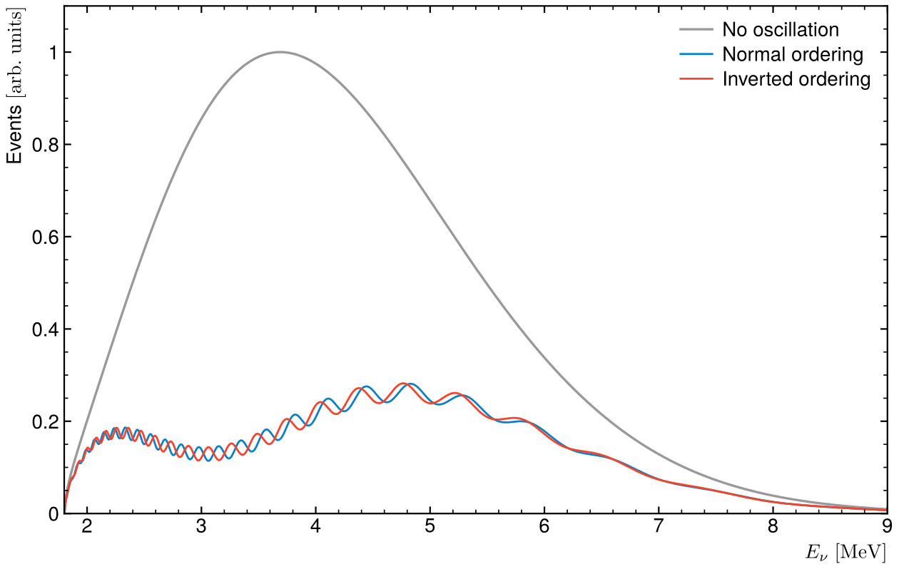
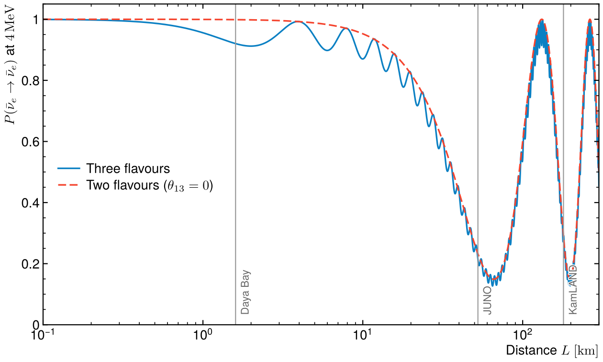
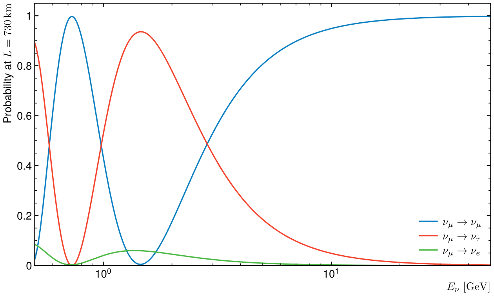

# Neutrino oscillations

Three-flavour oscillations in vacuum, from the PMNS matrix to the spectrum a
reactor experiment like JUNO would measure.



## Method

The flavour states (e, μ, τ) are mixtures of the mass states, through the PMNS
matrix U built from three angles and one CP phase. A neutrino of energy E born
as α is found as β after a distance L with probability

P(α → β) = |Σᵢ U_βi U*_αi exp(−i mᵢ² L / 2E)|².

The script builds U, computes the full 3 × 3 matrix of probabilities for any
L/E (antineutrinos with U*), and checks it three ways:

- unitarity: each row of probabilities sums to 1, to 10⁻¹²,
- the closed form of the electron antineutrino survival used by reactor
  experiments, P_ee = 1 − cos⁴θ₁₃ sin²2θ₁₂ sin²Δ₂₁ − sin²2θ₁₃(cos²θ₁₂ sin²Δ₃₁ + sin²θ₁₂ sin²Δ₃₂), to 10⁻¹²,
- the two-flavour formula when θ₁₃ = 0.

Parameters: PDG 2022 (sin²θ₁₂ = 0.307, sin²θ₁₃ = 0.0220, Δm²₂₁ = 7.53 × 10⁻⁵ eV²,
Δm²₃₂ = ±2.5 × 10⁻³ eV²).

## Result



At 4 MeV the electron antineutrino survival shows both oscillation lengths:
the small, fast one driven by θ₁₃ and Δm²₃₁, which Daya Bay measured at 1.6 km,
and the deep, slow one driven by θ₁₂ and Δm²₂₁, seen by KamLAND at ~180 km.
JUNO sits at 52.5 km, on the first slow minimum, where the fast wiggles ride
on top.

The first figure folds this into what a detector counts: a reactor's
antineutrino flux (Vogel–Engel fits for ²³⁵U, ²³⁹Pu, ²³⁸U and ²⁴¹Pu) times the
inverse-beta-decay cross section. The fast wiggles are shifted in phase
between the normal and inverted mass orderings. Measuring that shift is how
JUNO determines the ordering, and it requires an energy resolution of 3 % at
1 MeV.

For an accelerator beam over the 730 km from CERN to Gran Sasso, about 2 % of
the muon neutrinos at the CNGS mean energy (17 GeV) turn into tau neutrinos,
which OPERA looked for:



## Run

```
python3 oscillations.py
```

Needs numpy and matplotlib. Takes a second.

Rewritten from my L3 internship on two- and three-flavour neutrino oscillation
probabilities. The reactor flux and cross section here are textbook
approximations, not an experiment's model.
