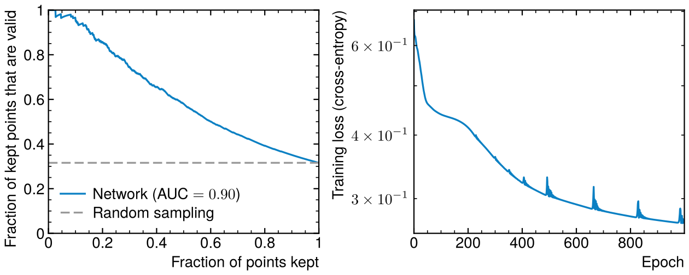
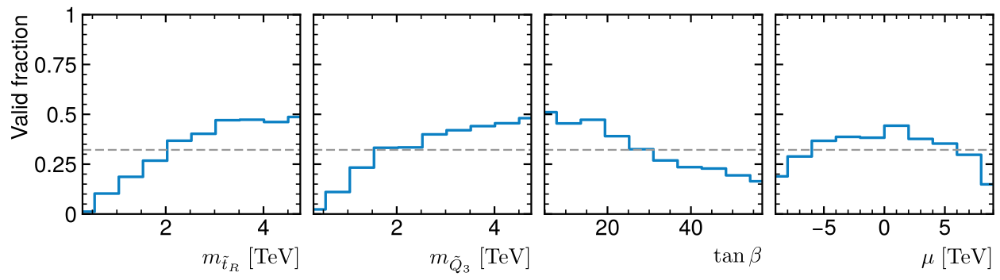
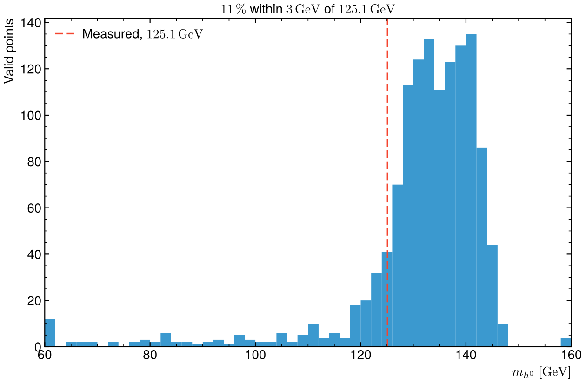

# Machine learning to sample the pMSSM

Supersymmetric models have many free parameters, and most random points in
them do not even give a physical particle spectrum. Here a small neural
network learns from the spectrum generator which points survive, so that a
scan can skip the ones likely to fail.



## Physics

The phenomenological MSSM (pMSSM) keeps 19 parameters of the Minimal
Supersymmetric Standard Model: the three gaugino masses M₁, M₂, M₃, the
higgsino mass μ, tan β, the pseudoscalar Higgs mass m_A, three trilinear
couplings and ten sfermion masses. `generate.py` draws 4000 points uniformly
(masses up to 5 TeV, |μ|, |A| up to 10 TeV, tan β from 2 to 60) and runs each
through SOFTSUSY 4.1.9, which solves the renormalisation group equations and
computes the pole masses. A point is rejected when SOFTSUSY flags a problem:
no electroweak symmetry breaking, a tachyonic sfermion, a charged lightest
superpartner, no convergence. Only 32 % of the points pass.

The failures are not random: points with light third-generation squarks or
a large tan β fail most often, and so do extreme values of μ. A network can
learn that structure.



## Network

`pmssm.py` trains a multilayer perceptron (19 → 32 → 32 → 1, tanh, sigmoid
output) written in plain numpy: forward pass, backpropagation by hand, binary
cross-entropy, Adam with weight decay. It trains on 70 % of the points and is
judged on the 30 % it never saw.

| On the 1200 test points | |
|---|---|
| ROC AUC | 0.90 |
| Valid fraction, random sampling | 32 % |
| Valid fraction, best-scored half | 58 % (× 1.8) |
| Valid points kept in that half | 92 % |

So half of the SOFTSUSY runs can be skipped while losing fewer than one valid
point in ten.

The lightest Higgs mass of the valid points sits mostly between 125 and
145 GeV, above the measured 125.1 GeV: with stops up to 5 TeV and large
mixing the loop corrections push m_h up, and only 11 % of the random valid
points land within 3 GeV of the measurement. That is the next constraint a
real scan would add.



## Run

```
python3 pmssm.py                                       # from the points.csv shipped here
python3 generate.py 4000 /path/to/softsusy/.libs/softpoint.x   # to regenerate it (~25 min)
```

`pmssm.py` needs numpy and matplotlib only and takes about 20 s. It fails if
the AUC is below 0.75, if the selected half is enriched by less than × 1.4, or
if fewer than 90 % of the valid points have m_h between 90 and 150 GeV.
`generate.py` needs a compiled [SOFTSUSY](https://softsusy.hepforge.org)
(B. C. Allanach, Comput. Phys. Commun. 143 (2002) 305).

Rewritten from my M1 internship at IP2I Lyon, *Machine learning applied to the
sampling of high-dimensional supersymmetric parameter spaces*. There, a
TensorFlow network generated the points itself and was steered by SOFTSUSY's
verdict. This version uses the simpler and more robust approach of a
classifier that filters random proposals.
