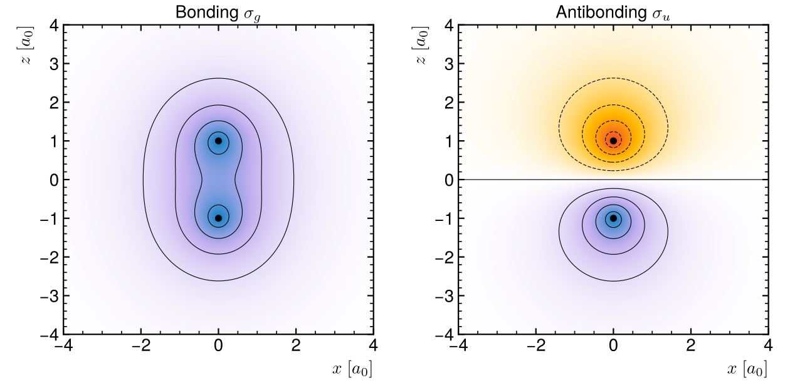
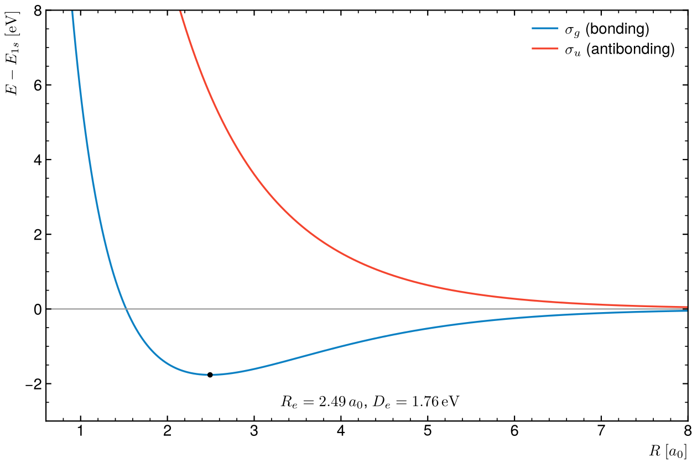
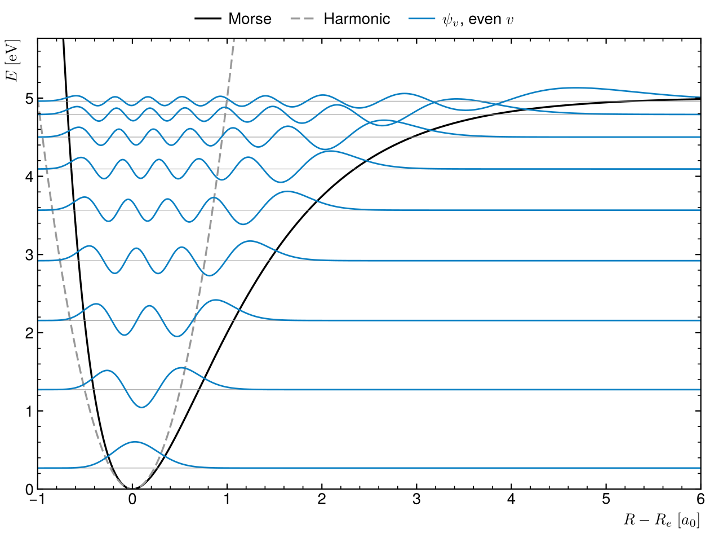

# The H₂ molecule: orbitals and vibrations

Two textbook pictures of the simplest molecules: the chemical bond of the H₂⁺
ion in the LCAO approximation, and the vibrational levels of H₂ in a Morse
potential.



## Chemical bond (LCAO)

The electron of H₂⁺ is written as a combination of the 1s orbitals of the two
protons, σ_g,u = (φ_a ± φ_b)/√(2(1 ± S)), with overlap
S(R) = e^(−R)(1 + R + R²/3). The bonding orbital σ_g piles charge between the
nuclei; σ_u has a node there. Their energies have a closed form in R
(Coulomb, exchange and overlap integrals of two 1s functions).

| | R_e | D_e |
|---|---|---|
| LCAO (this script) | 2.49 a₀ | 1.76 eV |
| Exact H₂⁺ | 2.00 a₀ | 2.79 eV |

A single 1s function per proton is too stiff: it binds, but too weakly and too
far out. The script checks the orbitals are normalised (cylindrical integral,
1.0000) and that the minimum lands at the known LCAO values.



## Vibrations (Morse)

The nuclei move in V(x) = D_e(1 − e^(−αx))² with the course values
D_e = 0.1842 Ha, α = 0.99852 a₀⁻¹, μ = 912.1 mₑ (ħω = 546 meV, close to H₂).
The 1D Schrödinger equation is solved with finite differences on 4000 points.
All 18 bound levels match the exact Morse spectrum
E_v = ħω(v + ½) − [ħω(v + ½)]²/(4D_e) within 0.21 meV. The levels get closer
towards the dissociation limit, where the harmonic approximation (dashed)
fails.



## Run

```
python3 h2.py
```

Needs numpy, scipy and matplotlib. Takes a few seconds.

Started from two L2–L3 scripts: the H₂⁺ orbitals (`orbitalesH2.py`) and the
harmonic eigenstates of H₂ (`oscillateur.py`).
