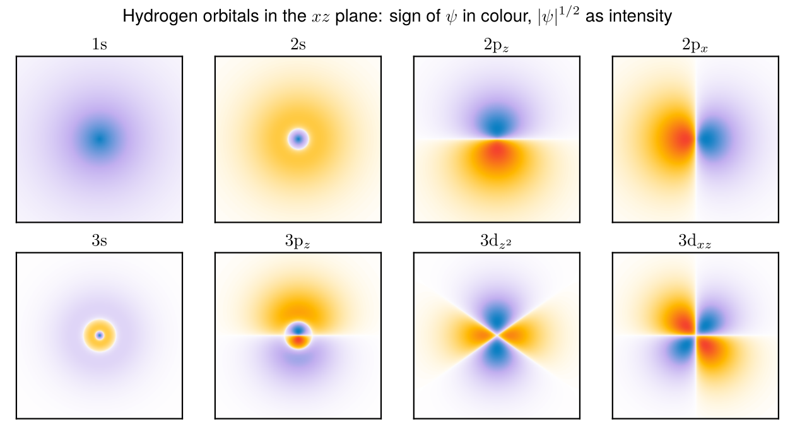
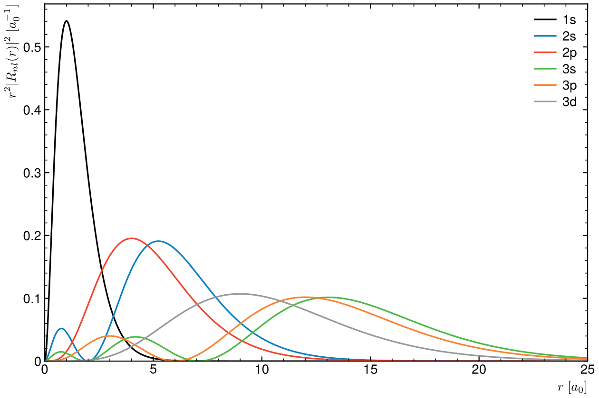
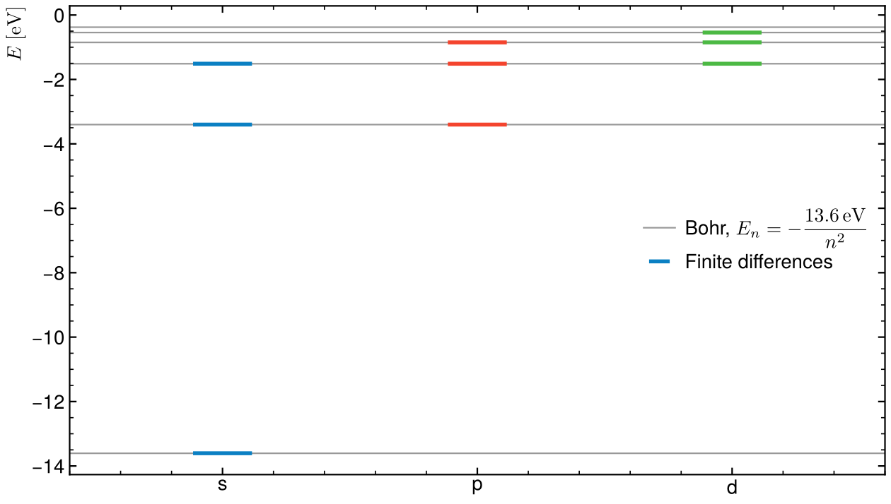

# Hydrogen atom

The bound states of hydrogen from the radial Schrödinger equation, solved
numerically and checked against Bohr's levels, and the s, p and d orbitals
drawn from the exact wave functions.





## Method

Atomic units (ħ = mₑ = e = 4πε₀ = 1). Writing ψ = R(r) Yₗₘ(θ, φ) and u = rR,
each angular momentum l gives a 1D problem

−½ u″ + [l(l+1)/(2r²) − 1/r] u = E u,   u(0) = u(r_max) = 0.

The second derivative is replaced by a three-point finite difference on 6000
points up to r_max = 80 a₀, which turns the equation into a tridiagonal
eigenvalue problem (`scipy.linalg.eigh_tridiagonal`).

## Result

| | n = 1 | n = 2 | n = 3 | n = 4 | n = 5 |
|---|---|---|---|---|---|
| s (eV) | −13.6051 | −3.4014 | −1.5117 | | |
| p (eV) | | −3.4014 | −1.5117 | −0.8504 | |
| d (eV) | | | −1.5117 | −0.8504 | −0.5442 |
| Bohr −13.6057/n² | −13.6057 | −3.4014 | −1.5117 | −0.8504 | −0.5442 |

The energy depends on n only (the l-degeneracy of the Coulomb potential), and
⟨r⟩ of the 1s state is 1.5000 a₀ (exact 3/2). The largest gap, 0.6 meV on 1s,
is the grid error near the nucleus where u varies fastest.



## Orbitals

`orbitals.py` writes ψ_nlm = R_nl(r) Y_lm with the real spherical harmonics
(p_x, p_z, d_xz, d_z², ...). The radial parts come from the closed form with
the associated Laguerre polynomials, and they are checked against the
finite-difference solutions above: for every state up to n = 3 the two agree
to 3 × 10⁻⁵ of the peak value. In the figure, the colour gives the sign of ψ
and the intensity |ψ|^(1/2), which brings out the outer lobes and the nodal
spheres (2s, 3s) and planes (p, d).

## Run

```
python3 hydrogen.py
python3 orbitals.py
```

Needs numpy, scipy and matplotlib. Takes a few seconds; fails if a level is off
Bohr's formula by more than 5 × 10⁻⁴ (relative).

Started from a first-year script computing Bohr's radii and energies by hand,
and from the hydrogen-orbital exercises of my L2 Python course.
