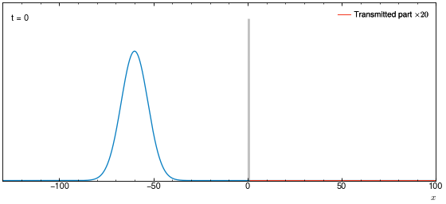
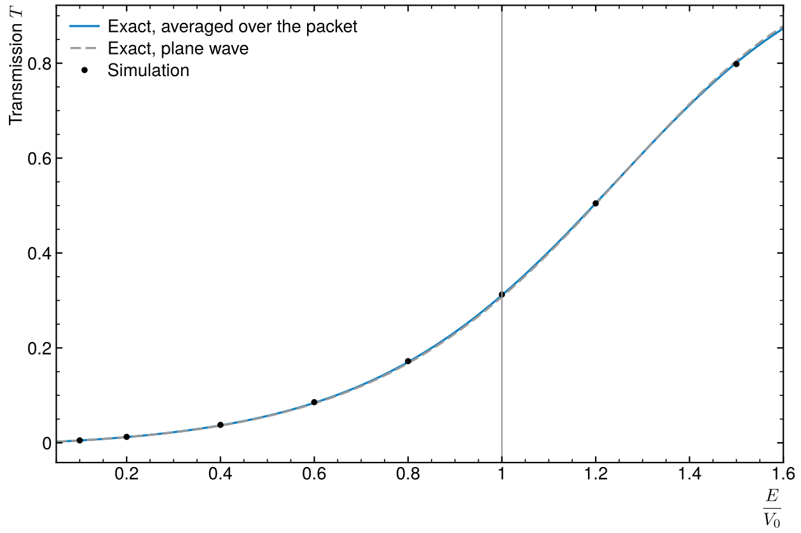
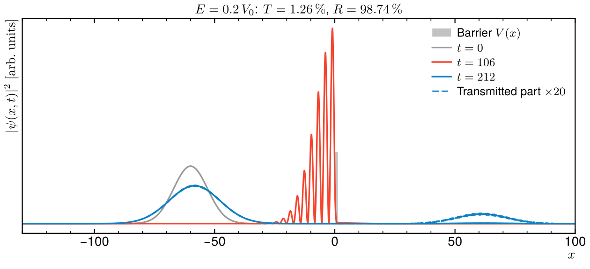

# Quantum tunnelling of a wave packet

A Gaussian wave packet hits a square barrier. The 1D time-dependent Schrödinger
equation is solved with the split-step Fourier method, and the transmitted
probability is checked against the exact result.



## Method

Units ħ = 1, particle mass m = 1.9, barrier height V₀ = 1.5 and width a = 3L with
L = ħ/√(2mV₀). Each time step applies half a potential step in position space,
a full kinetic step in momentum space (via FFT), then the other half potential
step. Every factor is a pure phase, so the norm is conserved to machine
precision and the error is of order dt².

For E < V₀ a plane wave crosses the barrier with probability

T(E) = [1 + V₀² sinh²(κa) / (4E(V₀ − E))]⁻¹,  κ = √(2m(V₀ − E))/ħ

and the packet's T is this curve averaged over its momentum distribution.

## Result

| E/V₀ | 0.1 | 0.2 | 0.4 | 0.6 | 0.8 | 1.0 | 1.2 | 1.5 |
|---|---|---|---|---|---|---|---|---|
| T simulated | 0.0051 | 0.0126 | 0.0378 | 0.0857 | 0.1721 | 0.3125 | 0.5046 | 0.7983 |
| T exact | 0.0050 | 0.0121 | 0.0367 | 0.0842 | 0.1702 | 0.3110 | 0.5049 | 0.8011 |

The largest gap (4 % at low energy) comes from the barrier being only 28 grid
points wide.




## Run

```
python3 tunnel.py
```

Needs numpy, matplotlib and Pillow. Takes about 40 s: it checks T against
theory at 8 energies (fails if off by more than 5 %), then writes the figures
and the GIF.

Method as in J. VanderPlas, *Quantum Python: Animating the Schrödinger
Equation* (2012). The code here is written from scratch.
