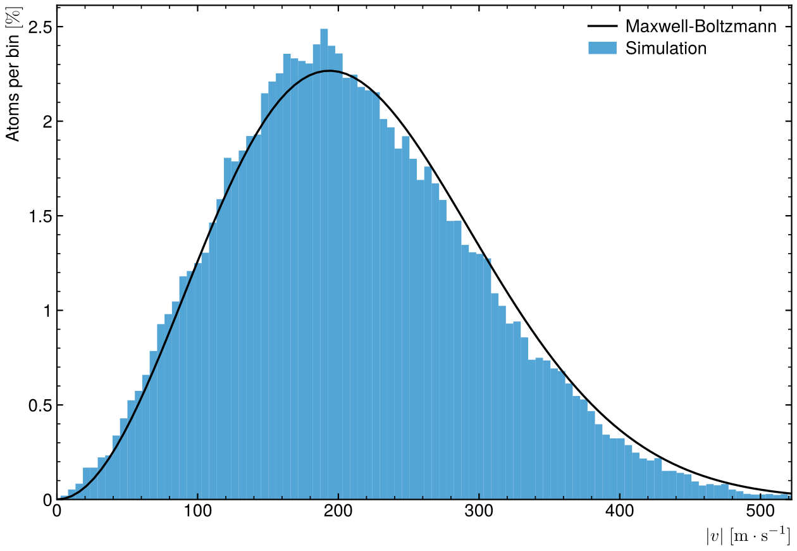
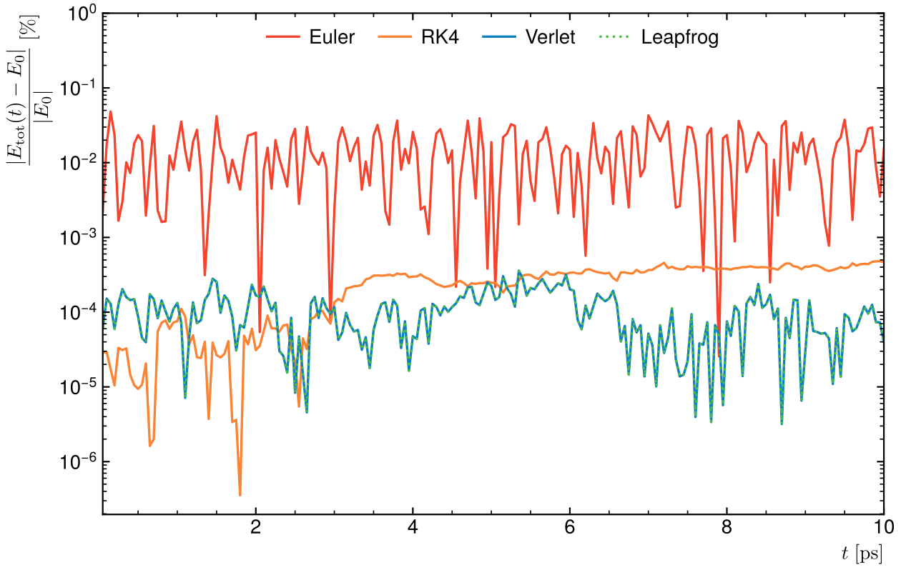
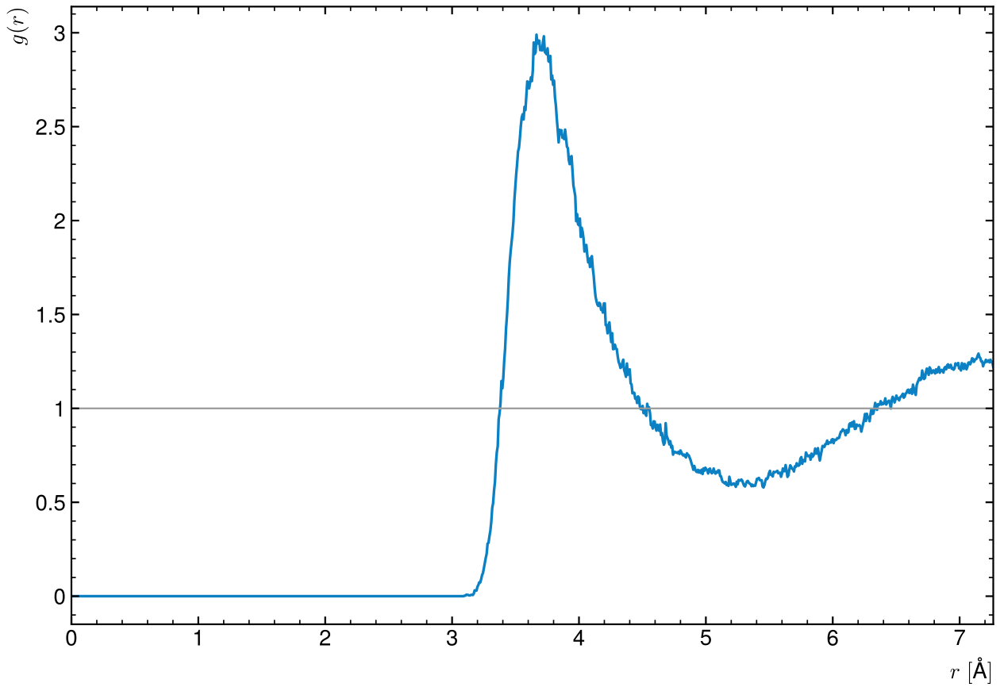
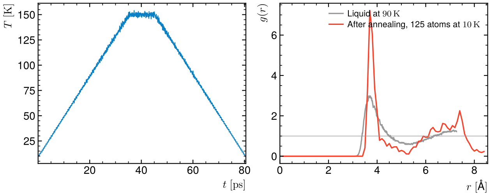

# Molecular dynamics of liquid argon (C++)

M1 project: N argon atoms in a periodic box interacting through
a Lennard-Jones potential, integrated in time to measure macroscopic
properties (energy, temperature, pressure, speed distribution, pair
correlation).



## Physics and numerics

- Lennard-Jones potential with the argon parameters ε = 0.0103 eV,
  σ = 3.405 Å, m = 39.948 u; periodic boundaries with the minimum-image
  convention. Atoms start on a cubic lattice with Maxwell-Boltzmann velocities.
- Four integrators to choose from: Euler, velocity Verlet, leapfrog and
  Runge-Kutta 4.
- Three ensembles: NVE (energy conserved), NVT (Berendsen thermostat) and NV,
  which heats then cools the system several times to look for its most stable
  geometry (simulated annealing).
- Outputs: energies, temperature, pressure, speed histograms with the
  Maxwell-Boltzmann curve, radial distribution function g(r), and positions
  as `.xyz` files for Jmol.

## Result

64 atoms of liquid argon at 90 K (ρ = 0.0208 Å⁻³), NVE, step 1 fs, 10 ps
(`src/CI_def.txt` as shipped).



Verlet and leapfrog are the same scheme written two ways, and give identical
energies (dotted on solid). Both keep the total energy within 4 × 10⁻⁴ % over
10 ps. Euler is about 130 times worse with the same step; it is the
semi-implicit variant (new velocity first, then position), so its error stays
bounded instead of growing. RK4 does as well as
Verlet here, at four force evaluations per step instead of one.

The speeds follow the Maxwell-Boltzmann distribution, and g(r)
shows the first-neighbour shell of a liquid at 3.7 Å, then a weaker second
shell:



## Simulated annealing

The NV mode heats the system step by step, holds it, then cools it back, to
look for the most stable arrangement of the atoms. Run here with 125 atoms at
ρ = 0.0250 Å⁻³, from 10 to 150 K and back in steps of 2 K, 0.5 ps per step
(lines 4, 5 and 15 to 22 of `CI_def.txt`, saved as
`src/Resultats/NV/CI_annealing.txt` after a run):



At 10 K the atoms are frozen in place: the first-neighbour peak of g(r) is
more than twice as high as in the liquid and g(r) falls almost to zero between the
shells. The second shell is split in two, with no peak at √2 times the
first-neighbour distance where a face-centred cubic crystal would put one.
That is an amorphous solid: cooling by 2 K every 0.5 ps is far too fast for
argon to crystallise, so the liquid structure is quenched into a glass.

## Build and run

```
cd src
make
./md
python3 ../plots/plot.py
```

Needs g++ and make; the plots need numpy and matplotlib. A run takes about
30 s and writes its output in `src/Resultats/`. To compare integrators, change
line 7 of `CI_def.txt` (0 Euler, 1 Verlet, 2 leapfrog, 3 RK4) and run again:
each method writes its own energy file.

## Parameters (`src/CI_def.txt`, one value per line)

| Line | Parameter |
|---|---|
| 1–3 | ε (eV), σ (nm), mass (u) |
| 4–6 | number of atoms N, density (atoms/ų), initial temperature (K) |
| 7 | integrator: 0 Euler, 1 Verlet, 2 leapfrog, 3 RK4 |
| 8–10 | time step (fs), total time (ps), thermalisation time (ps) |
| 11 | save every n steps |
| 12–13 | number of bins of the speed and g(r) histograms |
| 14 | Berendsen coupling constant (ps) |
| 15 | ensemble: `NVE`, `NVT` or `NV` |
| 16–21 | NV annealing: lowest and highest temperature (K), temperature step (K), time per temperature (ps), time at the top (ps), number of cycles |
| 22 | save every position (1) or the last one only (0) |

The program uses the largest cube strictly below N (`initialisePositions` fills a
simple cubic lattice), so N = 100 runs 64 atoms and N = 216 runs 125.

The code and its comments are in French, as written for the course. The only
change from the submitted version is the default density, lowered from
0.1 Å⁻³ (a compressed, repulsive system) to the density of liquid argon.
