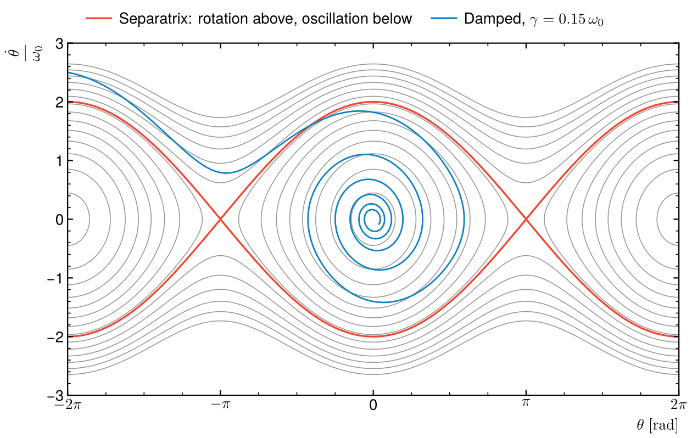
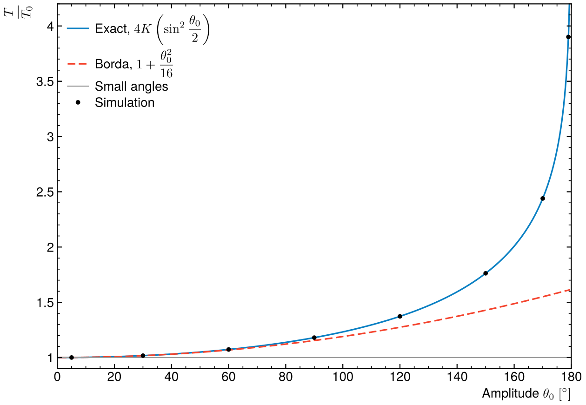

# Nonlinear pendulum

The simple pendulum without the small-angle approximation: how its period
grows with amplitude, and what its phase space looks like.



## Method

θ″ = −ω₀² sin θ − γθ′, integrated with scipy's adaptive Runge–Kutta (RK45)
at a relative tolerance of 10⁻¹¹. The period is the time between two
successive downward crossings of θ = 0, found by event detection. Units ω₀ = 1,
so the small-angle period is T₀ = 2π.

Without damping, energy conservation gives the period in closed form,
T = 4K(sin²(θ₀/2))/ω₀, with K the complete elliptic integral of the first kind.
Expanding it gives Borda's correction T₀(1 + θ₀²/16).

## Result

| θ₀ | 5° | 30° | 60° | 90° | 120° | 150° | 170° | 179° |
|---|---|---|---|---|---|---|---|---|
| T/T₀ | 1.000476 | 1.017409 | 1.073182 | 1.180341 | 1.372881 | 1.762204 | 2.439363 | 3.901065 |

All eight match the elliptic formula to the six digits shown. The period
diverges as θ₀ → 180°, where the pendulum takes forever to leave the unstable
top position. Borda's formula holds to about 60°.



In the phase portrait, closed curves are oscillations and open ones are full
rotations. The separatrix (red) between them passes through the unstable
equilibria at θ = ±π. A damped trajectory (blue) starts by rotating, crosses
the separatrix as it loses energy and spirals into θ = 0.

## Run

```
python3 pendulum.py
```

Needs numpy, scipy and matplotlib. Takes a few seconds. It fails if a period is
off the exact formula by more than 10⁻⁶ (relative).

Rewritten from my L2 Python course exercise (large angles, small angles and
damping, solved with `odeint`).
