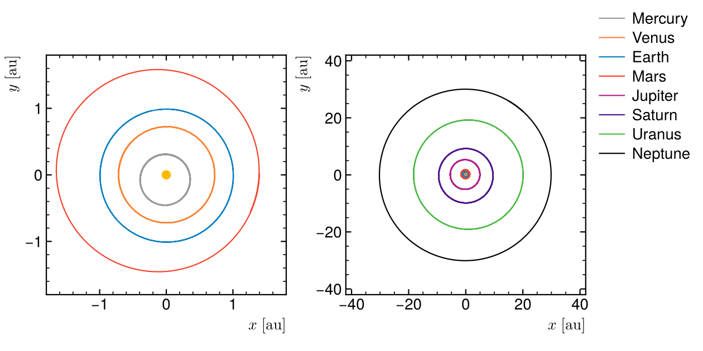
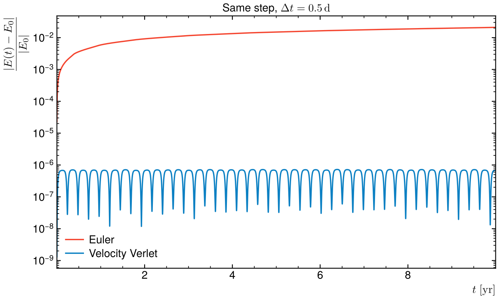

# Solar system

The Sun and the eight planets as a full N-body problem, integrated over one
orbit of Neptune.



## Method

Units: AU, year and solar mass, so G = 4π². Every body attracts every other
one. The equations of motion are pushed with velocity Verlet (half kick, drift,
half kick), which is symplectic: the energy oscillates around its initial value
instead of drifting.

Each planet starts at perihelion, at its real distance a(1 − e) and with the
vis-viva speed of its real orbit, all in one plane. A planet is placed relative
to the centre of mass of the Sun and the planets inside its orbit. Placing it
relative to the Sun instead gives Neptune the Sun's wobble around Jupiter
(~0.3 % of its speed) and biases its period by 1 %.

## Result

| Planet | Mercury | Venus | Earth | Mars | Jupiter | Saturn | Uranus | Neptune |
|---|---|---|---|---|---|---|---|---|
| T simulated (yr) | 0.241 | 0.615 | 1.000 | 1.881 | 11.871 | 29.405 | 83.995 | 164.761 |
| Kepler a^1.5 (yr) | 0.241 | 0.615 | 1.000 | 1.881 | 11.868 | 29.452 | 84.064 | 164.892 |

The outer planets differ from Kepler's third law by up to 0.2 % because they
pull on each other (Jupiter and Saturn most). With a step of half a day, the
total energy stays within 7 × 10⁻⁷ of its initial value over 170 years.
Explicit Euler with the same step loses 2 % in 10 years:



At 176 steps per orbit, Verlet makes Mercury's ellipse precess by about
10⁻³ rad per turn. This is a numerical effect, so the left panel shows the
inner planets over their first two years only.

## Run

```
python3 solar_system.py
```

Needs numpy and matplotlib. Takes about 10 s; fails if a period is off
Kepler by more than 0.5 % or if the energy drifts by more than 10⁻⁵.

Rewritten from earlier scripts of mine (orbits of the planets and of the
Moon, Euler against Verlet and leapfrog).
