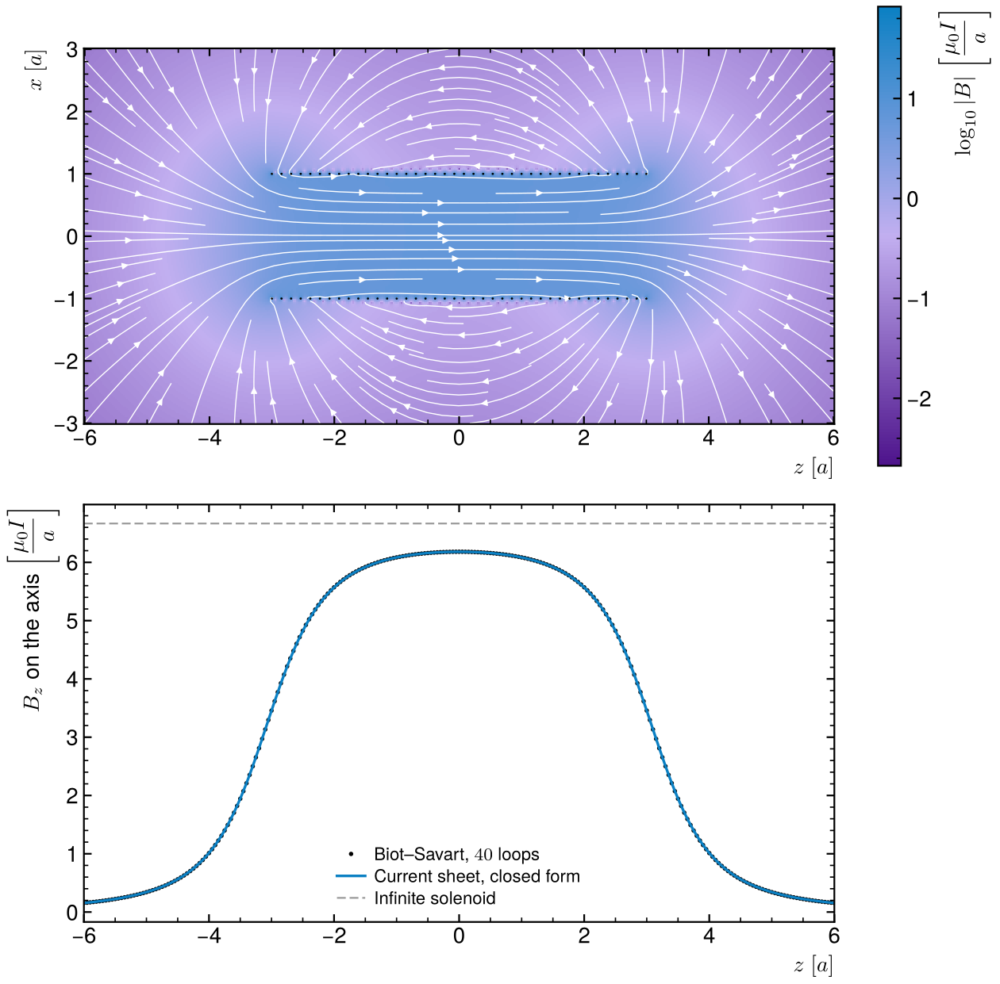

# Magnetic field of a solenoid

The field of a finite solenoid, everywhere in space, from the Biot–Savart law.



## Method

The solenoid is 40 circular loops of radius a spread over a length 6a. The
field of one loop at any point follows from Biot–Savart in closed form, with
the complete elliptic integrals K and E, so the wire is not cut into segments.
The solenoid's field is the sum over its loops. Units: μ₀I = 1, lengths in a.

## Result

Two checks against known results:

- One loop on its axis gives B_z = a²/(2(a² + z²)^(3/2)) to 10⁻⁶.
- On the axis of the solenoid, the sum over loops matches the closed form for
  a uniform current sheet,
  B_z = (μ₀nI/2)[(z + L/2)/√((z + L/2)² + a²) − (z − L/2)/√((z − L/2)² + a²)],
  within 0.2 %. The small gap comes from the loops being discrete.

At the centre B_z = 6.18 μ₀I/a, 7 % below the infinite-solenoid value μ₀nI:
a solenoid only six radii long still leaks field at its ends. Inside, the field
lines are nearly parallel. Outside, they close back around the coil as for a
bar magnet.

## Run

```
python3 solenoid.py
```

Needs numpy, scipy and matplotlib. Takes a few seconds.

Rewritten from my L2 Python course exercise, which integrated each loop
numerically with `quad` and traced the field lines with `odeint`.
