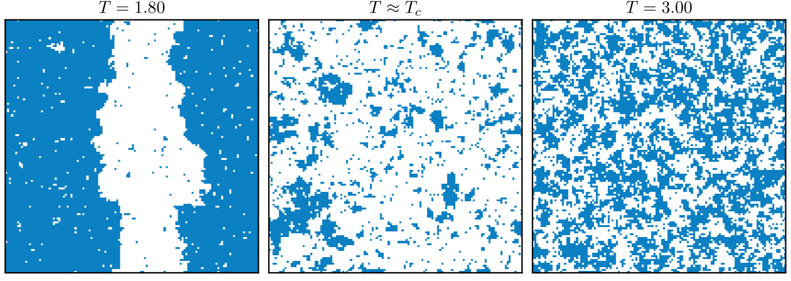
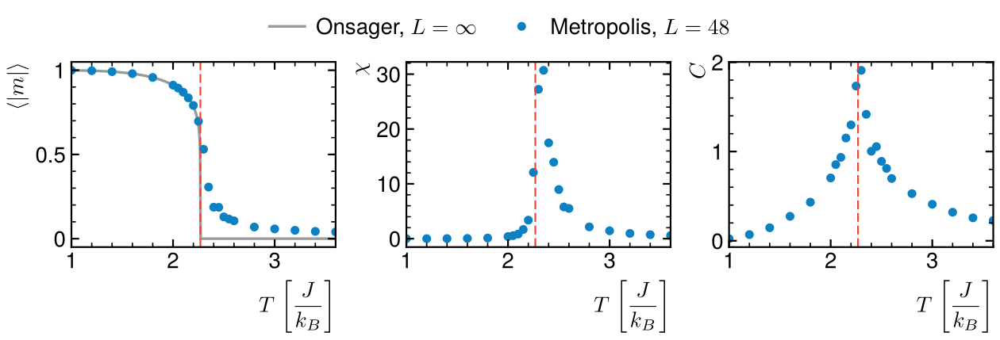

# 2D Ising model

The ferromagnetic–paramagnetic transition of the 2D Ising model with the
Metropolis algorithm, checked against Onsager's exact solution.



## Method

Spins s = ±1 on a 48 × 48 square lattice with periodic boundaries,
nearest-neighbour coupling J = 1 and no field (units J = k_B = 1). Flipping a
spin costs ΔE = 2s Σ(neighbours), and the flip is accepted with probability
min(1, e^(−ΔE/T)).

The lattice is updated as a checkerboard: spins of one colour have no
neighbour of the same colour, so half the lattice can be updated at once with
numpy instead of one random spin at a time. One sweep gives every spin one
trial. At each temperature: 1000 sweeps to thermalise (starting from the
previous temperature's configuration), then 4000 measured sweeps of ⟨|m|⟩, the
energy, the susceptibility χ = N var(|m|)/T and the heat capacity
C = N var(e)/T².

## Result



Below T = 2.1 the magnetisation matches Onsager's
M(T) = (1 − sinh(2/T)⁻⁴)^(1/8) to better than 0.01. Near
T_c = 2/ln(1 + √2) = 2.269 the finite lattice rounds the transition: |m|
stays non-zero just above T_c, and χ peaks at T = 2.35 instead of T_c. Both
shift towards T_c as L grows.

## Run

```
python3 ising.py
```

Needs numpy and matplotlib. Takes about 50 s; fails if |m| is off Onsager by
more than 0.02 below T = 2.1, or if χ peaks more than 0.15 away from T_c.

Rewritten from my L3 statistical physics lab script, which
used single-spin updates with numba.
